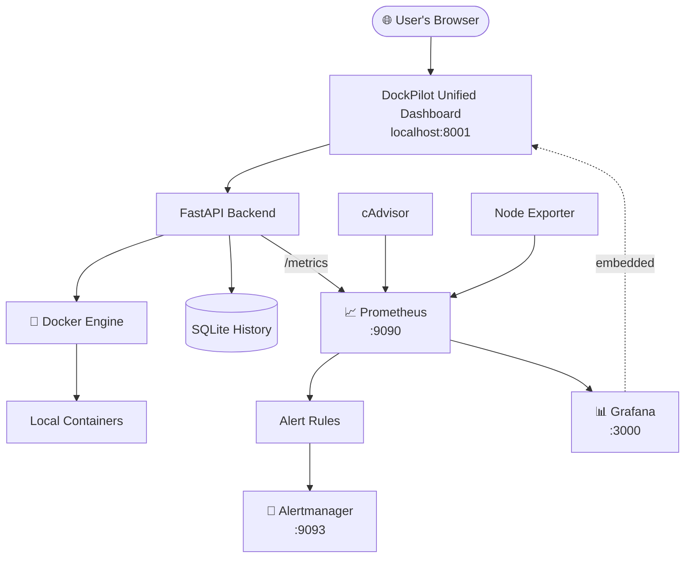

<div align="center">

# 🚢 DockPilot

### Docker Engine Management, Monitoring & Container Security Dashboard

*Manage Docker resources and monitor your local environment from one dashboard.*

<br>


[Quick Start](#-quick-start) •
[Features](#-features) •
[Architecture](#-architecture) •
[Monitoring](#-monitoring--alerting) •
[Troubleshooting](#-troubleshooting) •
[Security](#-security-notes)

</div>

---

> [!NOTE]
> DockPilot is designed for **local development, learning, testing, and demonstration**. Keep it on a trusted machine or network, and review authentication and network exposure before making it accessible to other users.

## 📖 Overview

Managing Docker containers usually means jumping between several CLI tools and monitoring UIs. **DockPilot** brings the main workflows into one unified web dashboard.

It talks to the local **Docker Engine** for real container data, uses **Prometheus** to collect metrics, **Grafana** to visualise them, and **Alertmanager** to handle alerts, all started with a few commands.

**Dashboard:** 👉 **http://localhost:8001**

<!--
## 📸 Screenshots
Add screenshots to docs/screenshots/ and uncomment:

| Dashboard | Grafana Monitoring |
|:---:|:---:|
|  |  |
-->

---

## ✨ Features

| | Feature | What you get |
|:-:|---|---|
| 🖥️ | **Unified Dashboard** | One interface with sidebar navigation for Docker, monitoring, security, alerts, incidents, history and settings, with Grafana embedded |
| 🐳 | **Docker Management** | List containers, start / stop / restart, view images, networks and volumes, inspect health and restarts, manage Compose configs |
| 📈 | **Resource Monitoring** | Container CPU, memory and network usage via cAdvisor, host metrics via Node Exporter, with historical data |
| 📊 | **Grafana Dashboards** | Pre-provisioned panels for system, CPU, memory, disk, containers, monitoring health and alerts |
| 🚨 | **Prometheus Alert Rules** | CPU, memory, disk, container and target-health alerts with configurable thresholds |
| 🔔 | **Alertmanager** | Severity routing, grouping, inhibition and optional email notifications |
| 🛡️ | **Security Checks** | Flags privileged containers, host network mode, risky bind mounts, seccomp / AppArmor settings |
| 🩺 | **Health & Incidents** | Container health, restart tracking and recorded incident history |
| 🗄️ | **Persistent History** | Metrics history stored in local SQLite, kept across restarts |

<details>
<summary><b>🔍 Alert rules covered</b></summary>
<br>

- High and critical **CPU** usage
- High and critical **memory** usage
- Low and critical **disk space**
- High **container** CPU and memory usage
- **Unhealthy** containers
- Unavailable monitoring **targets**
- Missing or empty **scrape results**

Thresholds and evaluation periods live in `prometheus/alert_rules.yml`. Review it before changing alert behaviour.

</details>

<details>
<summary><b>⚠️ Platform note for Node Exporter</b></summary>
<br>

When Node Exporter runs inside Docker Desktop, its metrics may describe the Linux environment used by Docker Desktop rather than every native Windows host metric. Interpret host-level panels accordingly.

</details>

---

## 🧰 Tech Stack

| Component | Purpose |
|---|---|
|  | Backend application logic |
|  | HTTP API and dashboard serving |
|  | Container management and runtime data |
|  | Monitoring service orchestration |
|  | Metrics collection and alert-rule evaluation |
|  | Dashboards and visualisation |
| **Alertmanager** | Alert grouping and routing |
| **cAdvisor** | Container resource metrics |
| **Node Exporter** | Host-environment metrics |
|  | Local application history |
| **HTML / CSS / JS** | Dashboard interface |
|  | Automated testing |

---

## 🏗️ Architecture



The dashboard is the primary interface. Supporting monitoring services run as separate background services connected through Docker networking.

---

## ⚡ Quick Start

### Prerequisites

- Windows 10/11 (or a compatible environment)
- **Docker Desktop** with Docker Engine running, plus Docker Compose
- **Python 3.10+**
- **Git** and a web browser

```cmd
docker --version
docker compose version
docker info
python --version
```

### 1️⃣ Clone the repository

```cmd
git clone https://github.com/kanishkaramesh60/DockPilot.git
cd DockPilot
```

### 2️⃣ Create a virtual environment and install dependencies

```cmd
python -m venv .venv
.venv\Scripts\activate
python -m pip install --upgrade pip
pip install -r requirements.txt
```

### 3️⃣ Start the monitoring stack

```cmd
docker compose -f monitoring-compose.yaml up -d
docker compose -f monitoring-compose.yaml ps
```

### 4️⃣ Start the DockPilot backend

```cmd
.venv\Scripts\python.exe -m uvicorn main:app --app-dir manager --host 0.0.0.0 --port 8001
```

> Keep this terminal running while you use the dashboard.

### 5️⃣ Open DockPilot 🎉

Visit **http://localhost:8001**

---

## 🔌 Service Ports

| Service | URL | Purpose | Exposure |
|---|---|---|:-:|
| **DockPilot** | http://localhost:8001 | Main unified dashboard | Host |
| **Prometheus** | http://localhost:9090 | Metrics and targets | Host |
| **Grafana** | http://localhost:3000 | Monitoring dashboards | Host |
| **Alertmanager** | http://localhost:9093 | Alert status and routing | Host |
| **cAdvisor** | http://localhost:8085 | Container metrics endpoint | Host |
| **Node Exporter** | `:9100` | Host metrics | Internal network |

The supporting interfaces are useful for administration and troubleshooting. The normal workflow starts from the DockPilot dashboard.

---

## 📡 Monitoring & Alerting

### Configuration files

| Component | File |
|---|---|
| Prometheus | `prometheus/prometheus.yml` |
| Alert rules | `prometheus/alert_rules.yml` |
| Grafana dashboard | `grafana/dashboards/dockpilot-monitoring.json` |
| Alertmanager | `alertmanager/alertmanager.yml` |
| Env template | `.env.example` |

Prometheus scrapes the monitoring services and DockPilot's metrics endpoint at `host.docker.internal:8001`.

### 📧 Enabling email notifications

1. Create a local `.env` from `.env.example`.
2. Enter valid SMTP settings locally.
3. Apply them if required:
   ```cmd
   python scripts\apply_alertmanager_env.py
   ```
4. Restart or reload the relevant monitoring service.
5. Trigger a controlled test alert and verify delivery.

> [!WARNING]
> Never commit `.env` or real credentials to GitHub. A successful local or mock-SMTP test does not by itself confirm delivery to an external inbox.

---

## 🧪 Running Tests

```cmd
.venv\Scripts\python.exe -m pytest -q
check-monitoring.bat
docker compose -f monitoring-compose.yaml ps
```

Also check Prometheus targets at http://localhost:9090/targets.

> A passing test suite is useful, but also verify manually that the dashboard shows live Docker data and that navigation and actions work.

---

## 📂 Project Structure

```text
DockPilot/
├── manager/                  # FastAPI backend
│   ├── main.py
│   ├── docker_service.py
│   ├── metrics_collector.py
│   ├── metrics_history.py
│   ├── failure_predictor.py
│   ├── incident_engine.py
│   └── ...
├── dashboard/
│   └── index.html            # Unified dashboard UI
├── prometheus/
│   ├── prometheus.yml
│   └── alert_rules.yml
├── grafana/
│   └── dashboards/
│       └── dockpilot-monitoring.json
├── alertmanager/
│   └── alertmanager.yml
├── scripts/
│   └── apply_alertmanager_env.py
├── tests/
├── data/
│   └── dockpilot_history.db
├── monitoring-compose.yaml
├── check-monitoring.bat
├── .env.example
├── requirements.txt
└── README.md
```

> Exact filenames may vary as the project evolves.

---

## ⚙️ Configuration

Review these before running:

- `monitoring-compose.yaml`: services, ports, networks, persistent volumes
- `prometheus/prometheus.yml`: scrape targets and Alertmanager integration
- `prometheus/alert_rules.yml`: thresholds and evaluation periods
- `grafana/`: dashboard provisioning
- `alertmanager/alertmanager.yml`: alert routing
- `.env.example`: optional environment variables

---

## 💾 Data Persistence & Safety

Docker volumes may hold Prometheus time-series data, Grafana state and Alertmanager data, and SQLite stores application history.

> [!CAUTION]
> Do **not** use these as routine cleanup. They can remove persistent data or resources the project needs:
> ```text
> docker compose down -v
> docker volume prune
> docker system prune
> ```

Prefer non-destructive inspection:

```cmd
docker compose -f monitoring-compose.yaml ps
docker volume ls
docker network ls
docker ps -a
```

Back up important files and database data before changing configuration or storage.

---

## 🛠️ Troubleshooting

<details>
<summary><b>Dashboard does not open</b></summary>
<br>

1. Confirm the backend terminal is still running.
2. Confirm port `8001` is listening.
3. Check the terminal for Python or FastAPI errors.
4. Open http://localhost:8001 again.

</details>

<details>
<summary><b>Monitoring services are unavailable</b></summary>
<br>

```cmd
docker compose -f monitoring-compose.yaml ps
docker compose -f monitoring-compose.yaml logs --tail=100 prometheus
docker compose -f monitoring-compose.yaml logs --tail=100 grafana
docker compose -f monitoring-compose.yaml logs --tail=100 alertmanager
```

</details>

<details>
<summary><b>A Prometheus target is down</b></summary>
<br>

1. Open http://localhost:9090/targets and find the failing target.
2. Inspect that service's logs.
3. Check the scrape target, Docker network and backend availability.
4. For the DockPilot target, confirm the backend is running on port `8001`.

</details>

<details>
<summary><b>Grafana does not appear inside DockPilot</b></summary>
<br>

1. Confirm Grafana is running.
2. Open http://localhost:3000 directly.
3. Check Grafana embedding and authentication settings.
4. Inspect the browser console for iframe or network errors.

</details>

<details>
<summary><b>Alert emails are not delivered</b></summary>
<br>

1. Verify the SMTP configuration in your local environment.
2. Check Alertmanager logs and its status page.
3. Confirm the alert reaches Alertmanager.
4. Test with a controlled alert.
5. Check the recipient inbox and spam folder.

</details>

---

## 🔐 Security Notes

- Run DockPilot only on **trusted machines and networks** unless access controls have been reviewed.
- The backend may bind to `0.0.0.0` so Docker Desktop containers can reach it via `host.docker.internal`. Depending on firewall settings, this can expose it on other network interfaces.
- Grafana **anonymous Viewer** access may be enabled for embedding. It is read-only, but review it before exposing the service beyond your machine.
- Never publish SMTP passwords, API keys, tokens or other secrets.
- Do not expose Docker management endpoints or privileged container controls to untrusted networks.
- Use least privilege for containers and mounts.
- The built-in security checks give configuration visibility. They are **not** a replacement for a full security audit.

---

## 🗺️ Future Scope

- [ ] Repeatable setup script for a fresh development environment
- [ ] Improved installation and configuration validation
- [ ] Additional automated integration tests
- [ ] Clearer operational documentation and demo scenarios

---

## 👤 Author

**DockPilot** by [kanishkaramesh60](https://github.com/kanishkaramesh60)

🔗 Repository: https://github.com/kanishkaramesh60/DockPilot

<div align="center">

<br>

⭐ *If you find this project useful, consider giving it a star!* ⭐

</div>
