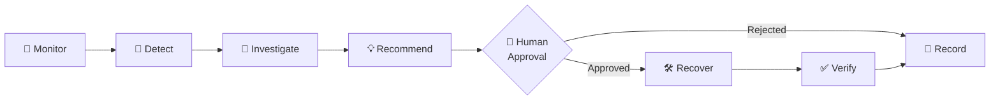
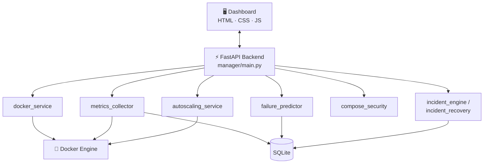

<div align="center">

# 🚢 DockPilot

### Docker Management, Monitoring & Container Security Dashboard

**Monitor → Detect → Investigate → Recommend → Approve → Recover → Verify → Record**

[](https://dockpilot-8vlo.onrender.com)
[](https://www.python.org/)
[](https://fastapi.tiangolo.com/)
[](https://www.docker.com/)
[](https://www.sqlite.org/)
[](https://docs.pytest.org/)

[**🌐 Live Demo**](https://dockpilot-8vlo.onrender.com) · [**📖 API Docs**](#-api-documentation) · [**🚀 Quick Start**](#-quick-start) · [**🗺️ Roadmap**](#️-roadmap)

</div>

---

## 📌 Overview

**DockPilot** is a web-based platform that brings Docker container operations, resource monitoring, predictive failure detection, security auditing, and guided incident recovery into a single dashboard.

Instead of juggling the CLI, separate monitoring tools, and manual security reviews, DockPilot gives you one place to **see what your containers are doing, catch problems early, harden your configurations, and recover safely with human approval**.

> 🔐 **Security-first by design:** Compose files are validated before deployment, and recovery actions are never executed without explicit human approval.

---

## 📑 Table of Contents

- [Key Features](#-key-features)
- [Incident Workflow](#-incident-intelligence--guided-recovery)
- [Tech Stack](#️-tech-stack)
- [Architecture](#️-architecture)
- [Quick Start](#-quick-start)
- [API Documentation](#-api-documentation)
- [Deployment](#-deployment-on-render)
- [Testing](#-testing)
- [Security Considerations](#-security-considerations)
- [Roadmap](#️-roadmap)
- [Contributing](#-contributing)
- [Author](#-author)

---

## ✨ Key Features

| | Feature | What it does |
|---|---|---|
| 🐳 | **Container Management** | View running and stopped containers; start, stop, restart, inspect, and read logs from one dashboard. |
| 📊 | **Real-Time Monitoring** | Track CPU, memory, and network activity with live charts and stored historical metrics. |
| 🔮 | **Predictive Failure Detection** | Analyze metrics to spot abnormal utilization patterns and flag likely failures before they happen. |
| ❤️ | **Health Monitoring** | Detect unhealthy, restarting, and repeatedly crashing containers, with a record of health events. |
| 🧾 | **Compose Management & Security** | Create and validate Docker Compose files, flagging risky settings before deployment. |
| 📈 | **Intelligent Autoscaling** | CPU-based scale-up/scale-down with min/max replica limits and cooldown periods. |
| 🛡️ | **Runtime Security Auditing** | Run security checks on containers and keep a searchable audit history. |
| 🧪 | **Resilience Testing** | Run controlled failure experiments and observe how containers recover. |
| 🚨 | **Incident Intelligence** | Detect, investigate, and recover from incidents with human-approved actions. |

<details>
<summary><b>🔍 Feature details (click to expand)</b></summary>

### 1. Docker Container Management
- View running and stopped containers
- Start, stop, and restart containers
- Inspect container details
- Access container logs
- Manage everything through a centralized dashboard

### 2. Real-Time Container Monitoring
- CPU utilization
- Memory consumption
- Network activity
- Graphical visualizations of resource usage
- Historical monitoring metrics

### 3. Predictive Container Failure Detection
- Analyzes container monitoring metrics
- Identifies potential container failures
- Detects abnormal resource utilization patterns
- Generates predictive insights for proactive maintenance

### 4. Container Health Monitoring
- Monitors container health status
- Identifies unhealthy and restarting containers
- Detects repeated container restarts
- Maintains health events and status information

### 5. Docker Compose Management & Security
- Create and manage Compose configurations
- Validate configurations before deployment
- Detect potentially insecure configurations, including:
  - ⚠️ Privileged container settings
  - ⚠️ Host networking
  - ⚠️ Unsafe security options
  - ⚠️ Sensitive host-path mounts
  - ⚠️ Docker socket mounts

### 6. Intelligent Container Autoscaling
- Monitors container resource utilization
- Applies CPU-based scaling policies
- Supports scale-up and scale-down decisions
- Configurable minimum and maximum replica limits
- Cooldown periods to prevent flapping
- Maintains autoscaling status and event history

### 7. Runtime Docker Security Auditing
- Performs security checks on Docker containers
- Identifies potential configuration risks
- Maintains security audit history
- Provides visibility into detected issues

### 8. Container Resilience Testing
- Controlled container resilience experiments
- Observes container behavior during failure scenarios
- Evaluates recovery behavior
- Maintains experiment history

</details>

---

## 🚨 Incident Intelligence & Guided Recovery

DockPilot follows a structured, auditable incident workflow where **a human always approves the fix**:



- **Detect** unhealthy, stopped, and repeatedly restarting containers
- **Investigate** detected incidents
- **Recommend** recovery actions
- **Require human approval** before running any supported recovery action
- **Verify** container status after recovery
- **Record** results and maintain a recovery history

---

## 🛠️ Tech Stack

| Category | Technologies |
|---|---|
| **Backend** | Python, FastAPI |
| **Frontend** | HTML, CSS, JavaScript |
| **Container Management** | Docker Engine, Docker SDK for Python |
| **System Monitoring** | psutil |
| **Config Validation** | PyYAML |
| **Database** | SQLite |
| **Visualization** | JavaScript Charts |
| **Testing** | Pytest |
| **Deployment** | Render |
| **Version Control** | Git, GitHub |

---

## 🏗️ Architecture



### Project Structure

```text
DockPilot/
├── dashboard/
│   └── index.html                  # Web dashboard (frontend)
│
├── manager/                        # FastAPI backend
│   ├── main.py                     # App entry point & API routes
│   ├── docker_service.py           # Docker Engine operations
│   ├── metrics_collector.py        # CPU / memory / network collection
│   ├── metrics_history.py          # Historical metrics storage
│   ├── autoscaling_service.py      # CPU-based autoscaling policies
│   ├── compose_security.py         # Compose validation & risk detection
│   ├── container_health.py         # Health & restart monitoring
│   ├── failure_predictor.py        # Predictive failure detection
│   ├── incident_engine.py          # Incident detection & investigation
│   ├── incident_recovery.py        # Approved recovery & verification
│   ├── resilience_lab.py           # Resilience experiments
│   ├── security_audit_history.py   # Security audit records
│   └── requirements.txt
│
├── compose_projects/               # Managed Compose projects
├── prometheus/                     # Monitoring configuration
├── tests/                          # Automated tests
├── data/                           # Local SQLite data
├── monitoring-compose.yaml
├── pytest.ini
└── README.md
```

---

## 🚀 Quick Start

### Prerequisites

- **Python 3.10+**
- **Docker Desktop** or **Docker Engine** (running)
- **Git**
- Windows, Linux, or macOS

### Installation

**1. Clone the repository**

```bash
git clone https://github.com/kanishkaramesh60/DockPilot.git
cd DockPilot
```

**2. Create and activate a virtual environment**

```bash
python -m venv venv
```

| OS | Activation command |
|---|---|
| Windows (CMD) | `venv\Scripts\activate` |
| Linux / macOS | `source venv/bin/activate` |

**3. Install dependencies**

```bash
pip install -r manager/requirements.txt
```

**4. Make sure Docker is running**

Docker Desktop or Docker Engine must be running and accessible to the application.

**5. Start the backend**

```bash
cd manager
python -m uvicorn main:app --reload --host 127.0.0.1 --port 8001
```

**6. Open DockPilot**

| | URL |
|---|---|
| 🖥️ Dashboard | http://127.0.0.1:8001 |
| 📖 API Docs (Swagger) | http://127.0.0.1:8001/docs |

---

## 📖 API Documentation

DockPilot is built on FastAPI, so interactive API documentation is generated automatically.

Once the server is running, visit:

- **Swagger UI:** `http://127.0.0.1:8001/docs`

---

## ☁️ Deployment on Render

The FastAPI web application is deployed on **Render**.

| Setting | Value |
|---|---|
| Service Type | Web Service |
| Runtime | Python 3 |
| Branch | `main` |
| Root Directory | *(blank)* |
| Build Command | `pip install -r manager/requirements.txt` |
| Start Command | `cd manager && uvicorn main:app --host 0.0.0.0 --port $PORT` |

**🔗 Live application:** https://dockpilot-8vlo.onrender.com

> [!NOTE]
> The hosted dashboard and backend run separately from any Docker Engine on your local machine. Remote container management requires a separately configured, **secure** Docker Engine connection. Local SQLite data also needs persistent storage to survive ephemeral hosting restarts.

---

## 🧪 Testing

DockPilot includes automated tests for its key components. From the project root:

```bash
python -m pytest -v
```

---

## 🔐 Security Considerations

> [!WARNING]
> Exposing the Docker API without authentication gives an attacker full control of the host. Never expose it publicly.

- ✅ Validate Docker Compose configurations before deployment
- ✅ Avoid privileged containers unless explicitly required
- ✅ Restrict host networking and sensitive volume mounts
- ✅ Protect Docker Engine access with authenticated, encrypted connections
- ❌ Do not expose an unauthenticated Docker API publicly
- ❌ Keep credentials and environment variables out of source control

---

## 🗺️ Roadmap

- [ ] Secure remote Docker Engine integration
- [ ] Multi-host Docker environment management
- [ ] Role-based access control (RBAC)
- [ ] Advanced anomaly detection
- [ ] Enhanced container security analytics
- [ ] Persistent cloud-based monitoring history
- [ ] Advanced incident investigation and automated verification

---

## 🎯 Project Objective

DockPilot aims to provide a centralized platform that combines container management, resource monitoring, predictive failure detection, security auditing, autoscaling, and guided incident recovery.

By pairing operational visibility with security-focused capabilities and human-approved recovery workflows, it makes container management **more efficient, more reliable, and more secure**.

---

## 🤝 Contributing

Contributions, issues, and feature requests are welcome!

1. Fork the repository
2. Create a feature branch: `git checkout -b feature/your-feature`
3. Commit your changes: `git commit -m "Add your feature"`
4. Push to the branch: `git push origin feature/your-feature`
5. Open a Pull Request

Please make sure the test suite passes (`python -m pytest -v`) before submitting.

---

## 👤 Author

**Kanishka Ramesh**
GitHub: [@kanishkaramesh60](https://github.com/kanishkaramesh60)

*Developed as a Cybersecurity and Cloud-Native Container Management project.*

---

<div align="center">

⭐ **If you find DockPilot useful, please consider starring the repository!** ⭐

</div>
