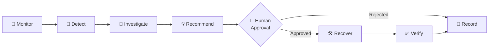
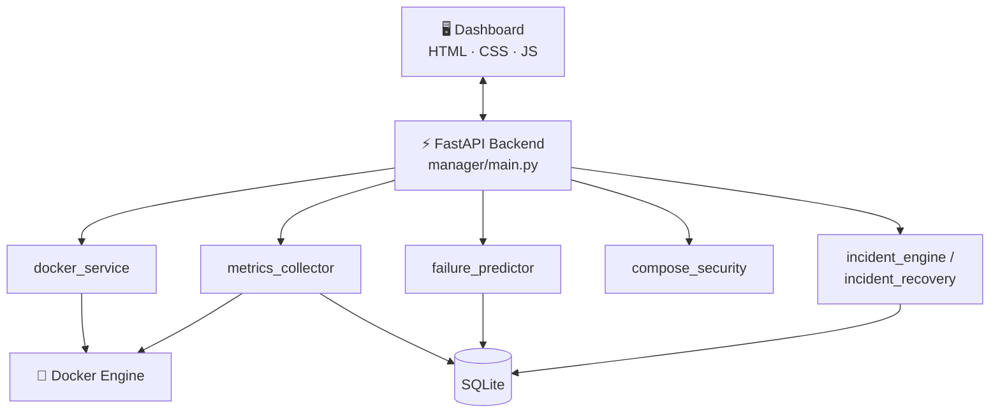

<div align="center">

# 🚢 DockPilot

### Docker Management, Monitoring & Container Security Dashboard

**Monitor → Detect → Investigate → Recommend → Approve → Recover → Verify → Record**

[](https://www.python.org/)
[](https://fastapi.tiangolo.com/)
[](https://www.docker.com/)
[](https://www.sqlite.org/)
[](https://docs.pytest.org/)

[**📖 API Docs**](#-api-documentation) · [**🚀 Quick Start**](#-quick-start) · [**🗺️ Roadmap**](#️-roadmap)

</div>

---

## 📌 Overview

**DockPilot** is a web-based platform that brings Docker container operations, resource monitoring, predictive failure detection, security auditing, and guided incident recovery into a single dashboard.

Instead of juggling the CLI, separate monitoring tools, and manual security reviews, DockPilot gives you one place to **see what your containers are doing, catch problems early, harden your configurations, and recover safely with human approval**.

> 🔐 **Security-first by design:** Compose files are validated before deployment, and recovery actions are never executed without explicit human approval.

---

## 📑 Table of Contents

- [Key Features](#-key-features)
- [Incident Workflow](#-incident-intelligence--guided-recovery)
- [Tech Stack](#️-tech-stack)
- [Architecture](#️-architecture)
- [Monitoring Infrastructure](#-monitoring-infrastructure-prometheus-cadvisor-node-exporter)
- [Quick Start](#-quick-start)
- [API Documentation](#-api-documentation)
- [Testing](#-testing)
- [Security Considerations](#-security-considerations)
- [Roadmap](#️-roadmap)
- [Author](#-author)

---

## ✨ Key Features

| | Feature | What it does |
|---|---|---|
| 🐳 | **Container Management** | View running and stopped containers; start, stop, restart, inspect, and read logs from one dashboard. |
| 📊 | **Real-Time Monitoring** | Track CPU, memory, and network activity with live charts and stored historical metrics. |
| 🔮 | **Predictive Failure Detection** | Analyze metrics to spot abnormal utilization patterns and flag likely failures before they happen. |
| ❤️ | **Health Monitoring** | Detect unhealthy, restarting, and repeatedly crashing containers, with a record of health events. |
| 🧾 | **Compose Management & Security** | Create and validate Docker Compose files, flagging risky settings before deployment. |
| 🛡️ | **Runtime Security Auditing** | Run security checks on containers and keep a searchable audit history. |
| 🚨 | **Incident Intelligence** | Detect, investigate, and recover from incidents with human-approved actions. |

<details>
<summary><b>🔍 Feature details (click to expand)</b></summary>

### 1. Docker Container Management
- View running and stopped containers
- Start, stop, and restart containers
- Inspect container details
- Access container logs
- Manage everything through a centralized dashboard

### 2. Real-Time Container Monitoring
- CPU utilization
- Memory consumption
- Network activity
- Graphical visualizations of resource usage
- Historical monitoring metrics

### 3. Predictive Container Failure Detection
- Analyzes container monitoring metrics
- Identifies potential container failures
- Detects abnormal resource utilization patterns
- Generates predictive insights for proactive maintenance

### 4. Container Health Monitoring
- Monitors container health status
- Identifies unhealthy and restarting containers
- Detects repeated container restarts
- Maintains health events and status information

### 5. Docker Compose Management & Security
- Create and manage Compose configurations
- Validate configurations before deployment
- Detect potentially insecure configurations, including:
  - ⚠️ Privileged container settings
  - ⚠️ Host networking
  - ⚠️ Unsafe security options
  - ⚠️ Sensitive host-path mounts
  - ⚠️ Docker socket mounts

### 6. Runtime Docker Security Auditing
- Performs security checks on Docker containers
- Identifies potential configuration risks
- Maintains security audit history
- Provides visibility into detected issues

</details>

---

## 🚨 Incident Intelligence & Guided Recovery

DockPilot follows a structured, auditable incident workflow where **a human always approves the fix**:



- **Detect** unhealthy, stopped, and repeatedly restarting containers
- **Investigate** detected incidents
- **Recommend** recovery actions
- **Require human approval** before running any supported recovery action
- **Verify** container status after recovery
- **Record** results and maintain a recovery history

---

## 🛠️ Tech Stack

| Category | Technologies |
|---|---|
| **Backend** | Python, FastAPI |
| **Frontend** | HTML, CSS, JavaScript |
| **Container Management** | Docker Engine, Docker SDK for Python |
| **System Monitoring** | psutil |
| **DevOps Monitoring** | Prometheus, cAdvisor, Node Exporter |
| **Config Validation** | PyYAML |
| **Database** | SQLite |
| **Visualization** | JavaScript Charts |
| **Testing** | Pytest |
| **Version Control** | Git, GitHub |

---

## 🏗️ Architecture



### Project Structure

```text
DockPilot/
├── dashboard/
│   └── index.html                  # Web dashboard (frontend)
│
├── manager/                        # FastAPI backend
│   ├── main.py                     # App entry point & API routes
│   ├── docker_service.py           # Docker Engine operations
│   ├── metrics_collector.py        # CPU / memory / network collection
│   ├── metrics_history.py          # Historical metrics storage
│   ├── compose_security.py         # Compose validation & risk detection
│   ├── container_health.py         # Health & restart monitoring
│   ├── failure_predictor.py        # Predictive failure detection
│   ├── incident_engine.py          # Incident detection & investigation
│   ├── incident_recovery.py        # Approved recovery & verification
│   ├── security_audit_history.py   # Security audit records
│   └── requirements.txt
│
├── compose_projects/               # Managed Compose projects
├── prometheus/                     # Prometheus configuration (prometheus.yml)
├── tests/                          # Automated tests
├── data/                           # Local SQLite data
├── monitoring-compose.yaml         # Compose file for Prometheus, cAdvisor, and Node Exporter
├── check-monitoring.bat            # Windows monitoring health check script
├── pytest.ini
└── README.md
```

---

## 📈 Monitoring Infrastructure (Prometheus, cAdvisor, Node Exporter)

DockPilot features a dedicated DevOps monitoring infrastructure orchestrated via Docker Compose (`monitoring-compose.yaml`). This stack provides real-time container metrics, host environment telemetry, and time-series data storage.

### 🏛️ Monitoring Architecture

```mermaid
flowchart TB
    subgraph Host["Host Operating System (Windows / Docker Desktop Linux VM)"]
        NE["📊 Node Exporter<br/>dockpilot-node-exporter<br/>Port :9100 (Internal)"]
        CA["📈 cAdvisor<br/>dockpilot-cadvisor<br/>Port 8085 -> :8080"]
        Containers["🐳 Managed Containers / Host Resources"]
    end

    subgraph Monitoring["Docker Network: dockpilot-monitoring"]
        PROM["🔥 Prometheus TSDB<br/>dockpilot-prometheus<br/>Port 9090 -> :9090"]
        VOL[("💾 Persistent Volume<br/>dockpilot_prometheus_data")]
    end

    Containers -->|Container Stats & Cgroups| CA
    Host -->|Kernel /proc & /sys & rootfs| NE
    PROM -->|Scrape :8080/metrics (10s)| CA
    PROM -->|Scrape :9100/metrics (10s)| NE
    PROM -->|Scrape :9090/metrics (10s)| PROM
    PROM -->|Store Metrics (3d TSDB)| VOL
```

### 🔌 Services and Ports

| Service | Container Name | Image | Published Host Port | Internal Network Port | Description |
|---|---|---|---|---|---|
| **Prometheus** | `dockpilot-prometheus` | `prom/prometheus:latest` | `9090` | `9090` | Time-series database, metrics scraper, and query engine. Scrapes all targets every 10s. |
| **cAdvisor** | `dockpilot-cadvisor` | `gcr.io/cadvisor/cadvisor:latest` | `8085` | `8080` | Real-time container resource, CPU, memory, and network usage analyzer. |
| **Node Exporter** | `dockpilot-node-exporter` | `prom/node-exporter:latest` | *None (Internal only)* | `9100` | Hardware and OS metrics exporter. Scraped internally on `dockpilot-monitoring` to avoid host port conflicts. |

> [!NOTE]
> **Host Port Conflict Prevention:** Node Exporter does not bind to a host port. Its metrics endpoint (`:9100`) is exposed exclusively on the internal `dockpilot-monitoring` network for Prometheus. This prevents port conflicts with any services or exporters running on the Windows host.

### ⚠️ Node Exporter Docker Desktop / Linux Monitoring Limitation

> [!IMPORTANT]
> **Scope of Monitored Environment:**
> When running Docker Desktop on Windows, Docker operates inside a virtualized Linux utility environment (via WSL 2 or Hyper-V).
> - Node Exporter mounts `/proc:/host/proc:ro`, `/sys:/host/sys:ro`, and `/:/rootfs:ro` from this virtualized Linux environment.
> - Consequently, **Node Exporter collects telemetry for the Docker Desktop Linux guest environment** (CPU cores assigned to WSL2/Hyper-V, Linux memory allocations, virtual disk I/O, and Linux system load).
> - **It does not monitor native Windows host OS processes, native Windows services, or Windows registry/hardware counters.**
> - To monitor native Windows host resources outside Docker Desktop, a native Windows exporter (such as Prometheus `windows_exporter` / `WMI exporter`) must be installed and run as a Windows service on the host.

### 📋 Prerequisites

- **Docker Desktop** (version 20.10+ / 24+ / 29+) with WSL 2 or Hyper-V backend running.
- **Docker Compose** (v2.x or v5.x+).
- **Windows Command Prompt (cmd.exe)** or **PowerShell** with `curl` available.
- Ports `9090` (Prometheus) and `8085` (cAdvisor) free on the host.

### 📦 Installation & Setup

1. **Verify Docker Desktop is running:**
   ```cmd
   docker info
   ```
2. **Ensure network and persistent volume readiness:**
   The network `dockpilot-monitoring` and TSDB volume `dockpilot_prometheus_data` are automatically managed by Docker Compose.

### 🚀 Startup Commands

To start the monitoring infrastructure:

```cmd
cd /d D:\CyberProjects\dockpilot
docker compose -f monitoring-compose.yaml config
docker compose -f monitoring-compose.yaml up -d
docker ps
```

### ✅ Verification Steps

#### 1. Automated Health Check Script
Run the automated Windows health check script from the project root:

```cmd
check-monitoring.bat
```

This script verifies:
- Docker daemon connectivity.
- Running status and health for `dockpilot-prometheus`, `dockpilot-cadvisor`, and `dockpilot-node-exporter`.
- Prometheus server readiness (`http://localhost:9090/-/healthy`).
- Prometheus target health for `prometheus`, `cadvisor`, and `node-exporter` (all expected `UP`).
- Node Exporter internal metric availability and Prometheus scraping of `node_cpu_seconds_total` and `node_memory_MemAvailable_bytes`.
- cAdvisor dashboard access (`http://localhost:8085`) and `container_cpu_usage_seconds_total` scraping.

#### 2. Prometheus Targets UI
Open your browser to:
[http://localhost:9090/targets](http://localhost:9090/targets)

Expected active targets:
- `prometheus` – **UP** (`http://prometheus:9090/metrics`)
- `cadvisor` – **UP** (`http://cadvisor:8080/metrics`)
- `node-exporter` – **UP** (`http://node-exporter:9100/metrics`)

#### 3. Prometheus Metric Queries
Navigate to [http://localhost:9090/graph](http://localhost:9090/graph) and test the following PromQL queries:

- **Node Exporter CPU metrics:**
  ```promql
  node_cpu_seconds_total
  ```
- **Node Exporter Available Memory:**
  ```promql
  node_memory_MemAvailable_bytes
  ```
- **cAdvisor Container CPU Usage:**
  ```promql
  container_cpu_usage_seconds_total
  ```

#### 4. cAdvisor Web Dashboard
Navigate to:
[http://localhost:8085](http://localhost:8085) or [http://localhost:8085/containers/](http://localhost:8085/containers/)
to inspect real-time container metrics, subcontainers, and driver details.

### 🔧 Troubleshooting

| Issue | Cause | Resolution |
|---|---|---|
| **Port Conflict on 9090 or 8085** | Another process is using port 9090 or 8085 on the host. | Run `netstat -ano \| findstr :9090` to find the offending PID, or adjust the host port mapping in `monitoring-compose.yaml`. |
| **`node-exporter` Target DOWN in Prometheus** | DNS or network resolution issue between containers. | Verify both containers are attached to `dockpilot-monitoring` via `docker network inspect dockpilot-monitoring`. Check container logs with `docker logs dockpilot-node-exporter`. |
| **Compose Volume Loss Concern** | Accidental volume pruning. | Never run `docker compose down -v`. The TSDB volume `dockpilot_prometheus_data` is preserved across container restarts and updates. |
| **Container Fails with Mount Error** | Docker Desktop file sharing permissions. | Ensure Docker Desktop has permission to access host drives and that WSL 2 integration is enabled. |

---

## 🚀 Quick Start

### Prerequisites

- **Python 3.10+**
- **Docker Desktop** or **Docker Engine** (running)
- **Git**
- Windows, Linux, or macOS

### Installation

**1. Clone the repository**

```bash
git clone https://github.com/kanishkaramesh60/DockPilot.git
cd DockPilot
```

**2. Create and activate a virtual environment**

```bash
python -m venv venv
```

| OS | Activation command |
|---|---|
| Windows (CMD) | `venv\Scripts\activate` |
| Linux / macOS | `source venv/bin/activate` |

**3. Install dependencies**

```bash
pip install -r manager/requirements.txt
```

**4. Make sure Docker is running**

Docker Desktop or Docker Engine must be running and accessible to the application.

**5. Start the backend**

```bash
cd manager
python -m uvicorn main:app --reload --host 127.0.0.1 --port 8001
```

**6. Open DockPilot**

| | URL |
|---|---|
| 🖥️ Dashboard | http://127.0.0.1:8001 |
| 📖 API Docs (Swagger) | http://127.0.0.1:8001/docs |

---

## 📖 API Documentation

DockPilot is built on FastAPI, so interactive API documentation is generated automatically.

Once the server is running, visit:

- **Swagger UI:** `http://127.0.0.1:8001/docs`

---

## 🧪 Testing

DockPilot includes automated tests for its key components. From the project root:

```bash
python -m pytest -v
```

---

## 🔐 Security Considerations

> [!WARNING]
> Exposing the Docker API without authentication gives an attacker full control of the host. Never expose it publicly.

- ✅ Validate Docker Compose configurations before deployment
- ✅ Avoid privileged containers unless explicitly required
- ✅ Restrict host networking and sensitive volume mounts
- ✅ Protect Docker Engine access with authenticated, encrypted connections
- ❌ Do not expose an unauthenticated Docker API publicly
- ❌ Keep credentials and environment variables out of source control

---

## 🗺️ Roadmap

- [ ] Secure remote Docker Engine integration
- [ ] Multi-host Docker environment management
- [ ] Role-based access control (RBAC)
- [ ] Advanced anomaly detection
- [ ] Enhanced container security analytics
- [ ] Persistent cloud-based monitoring history
- [ ] Advanced incident investigation and automated verification

---

## 🎯 Project Objective

DockPilot aims to provide a centralized platform that combines container management, resource monitoring, predictive failure detection, security auditing, and guided incident recovery.

By pairing operational visibility with security-focused capabilities and human-approved recovery workflows, it makes container management **more efficient, more reliable, and more secure**.

---

## 👤 Author

**Kanishka R**
GitHub: [@kanishkaramesh60](https://github.com/kanishkaramesh60)

*Developed as a Cybersecurity and Cloud-Native Container Management project.*

---

<div align="center">

⭐ **If you find DockPilot useful, please consider starring the repository!** ⭐

</div>
